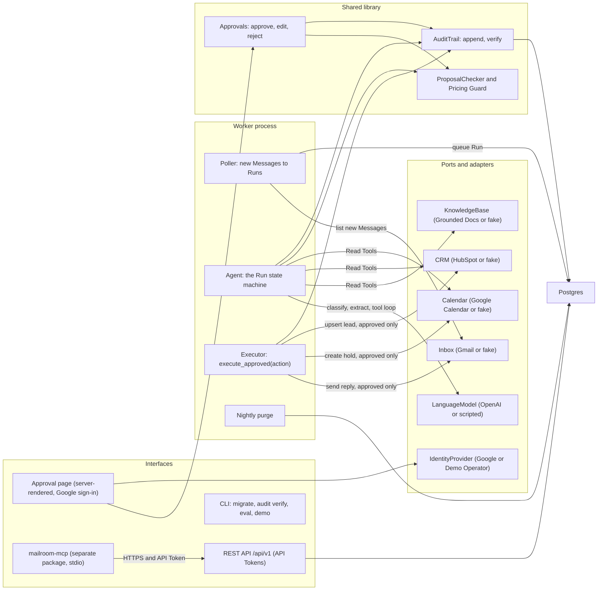
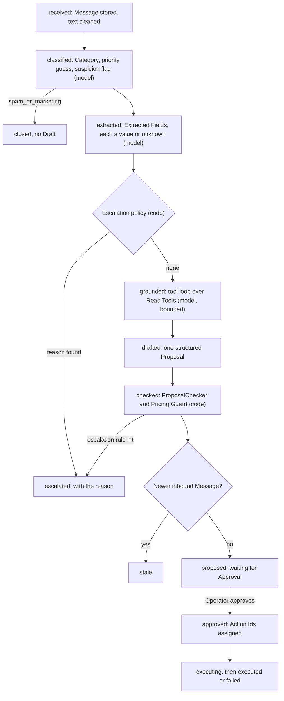
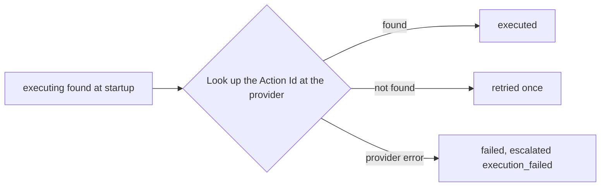

# Mailroom architecture

This is the design document of the private Mailroom repository, as it stands for version 1.0.0. Names in `code` are modules, functions and settings in that repository.

Mailroom's value is that nothing leaves the business without a person's approval, even when the model is fooled by a hostile email. Everything below follows from that.

## System

One image, four Compose services. `postgres` starts first. `migrate` then runs once and exits, the only service holding the database owner's credentials. `web` (page and REST API) and `worker` (Poller, Agent, Executor, purge) start after it and connect as the app role `mailroom_app`. A stuck model call in `worker` never blocks the page, and a page crash never stops a Run. The optional `knowledge` profile adds Grounded Docs on an internal network; since it has no API authentication, it publishes no port.

## The Run pipeline

Every arrow is a persisted transition and an Audit Trail event, so a restart resumes from Postgres and nothing lives in memory. A Budget overrun at any step before `proposed` goes to `escalated` with `budget_exhausted`, its partial work kept. A Run ends when it proposes; Approval executes the Proposal with no further model call.

## The safety boundary

**The model can only read.** Inside the `grounded` state it runs a bounded tool-calling loop over Read Tools (search the Knowledge Base, look up a contact, check availability), then returns one structured Proposal: a Draft and zero or more Actions. It has no tool that writes. Code validates the Proposal, and the only path to an external write is `execute_approved(action)` after an Approval. So "unapproved external writes = 0" holds by construction, a test asserts no adapter write is reachable any other way, and the evaluation measures it from the fakes' write logs.

Alternatives considered:

- **A fixed pipeline with no tool choice.** Most predictable, but the model could not decide what it needs to look up.
- **A full agent loop with write tools behind an interceptor.** Safety would depend on every write tool, including future ones, being wrapped. Approval pauses would land mid-reasoning, so resuming means continuing a stale model conversation hours later, and the model could chain further writes on a result. Operators would approve writes one by one out of context, and an injected email could flood the queue and win by approval fatigue.
- **An agent framework or vendor SDK.** Gives checkpointing and interrupts, but puts the safety boundary inside a framework's semantics and adds a heavy dependency.

**If you know LangGraph**, this is its "human approval of the final plan" pattern, written by hand. The persisted Run states are the checkpointer, `grounded` is one node holding a tool loop, `proposed` is an `interrupt`, and an Approval is the resume. The difference is what resume does: it runs code only, with no model call and no stale conversation. Multi-step workflows whose later steps depend on earlier writes' results do not fit this shape, and that would be a new decision.

**Code, not the model, decides what a Proposal can do:**

| Defence | What it does |
| --- | --- |
| Recipient set by code | The reply always goes to the thread's sender. A Proposal has no recipient field for the model to fill. |
| Text cleaning | HTML is stripped to visible text; hidden text is removed and counted. Attachments are never opened. |
| Fencing | Email text, quoted replies and tool results reach the model marked as data. So do the four Extracted Fields the draft step reads (customer name, event date, guest count, package), through `prompts.draft_input`, because those values came from the sender. |
| Suspicion check | An email with instructions aimed at an assistant escalates as `suspected_injection`. |
| Pricing Guard | An amount not on the Catalog blocks the Proposal until an Operator fixes it or confirms it as their own quote. |
| Citation tracing | A Draft's Citations must come from this Run's tool results. |
| Action checks | `proposal_checker._matching_actions` drops any Action the thread does not support, with a warning to the Operator. A calendar date must appear in the thread. A CRM lead is dropped unless the Category is in `LEAD_CATEGORIES` (`new_inquiry`, `pricing_request`) and a stated event date is at least `MIN_BOOKING_NOTICE` (14 days) after the latest Message. The model is told when to propose a lead, but a rule code can decide stays with code. |
| API and MCP | API Tokens are refused on decision routes. The most a token can do is ask for a redraft, which still waits for an Operator. |

These lower how often an attack works; the Approval limits what it can do when one does. Prompt injection is not solved, and the design does not assume it is.

## Idempotent execution

An Action can crash between "the email was sent" and "we recorded that it was sent". Retrying would send it twice, and giving up would lose an approved reply.

Each approved Action gets an Action Id. Mailroom records `executing` before the external call and `executed` with the provider's id after it, and writes the Action Id into the object it creates: an `X-Mailroom-Action` header on the Gmail message, `extendedProperties` on the Calendar event, a custom property on the HubSpot record. On restart, `reconcile()` looks up each `executing` Action by its Id:

The exception to the last arrow is a CRM lead: its reply has already gone, so it joins the CRM retries instead. Execution order is calendar hold, reply, CRM lead, so a slot taken meanwhile stops before anything is sent, and a CRM failure never undoes a sent reply. Availability is re-checked just before the hold; if the slot is busy, a new Run starts with that fact as context, never a silent retry with different arguments.

## Audit chain

`audit_events` has one row per state transition, tool call, Proposal, Approval or rejection (with the Operator's email) and Action result, including the exact proposed and sent text. Each row stores the hash of the previous row, and `mailroom audit verify` recomputes the chain to detect an edited or deleted row. The app role may only INSERT and SELECT this table, so no code path in `web` or `worker` can rewrite history.

Retention and evidence meet in one place. The purge clears old bodies through `purge_audit_bodies`, the one change the app role may make: it clears a body and nothing else, after appending the purge's own event. Each row keeps its body's hash, so the chain still verifies.

Logs were not enough for this: they rotate, hold no email text by policy, and cannot show that nothing was changed. An external tracing platform would send email content to another service and still prove nothing.

## Failure modes

| Failure | Behaviour |
| --- | --- |
| Model timeout, 429 or 5xx | 20 s per call, up to 3 tries with backoff and jitter inside the Run's Budget; then the Run is re-queued (1, 5, 25 minutes), then escalated `agent_unavailable`. Billing errors and other 4xx are not retried. |
| Malformed structured output | Up to 2 retries with the validation error, then escalated `invalid_output`. |
| Knowledge Base unreachable, 503 or 429 | A retryable Run failure as above, never "not found in the Knowledge Base". |
| Budget exceeded (steps, cost, time) | Escalated `budget_exhausted`; partial work stays in the Audit Trail. |
| Daily spend limit reached | Queued Runs wait until 00:00 UTC; `/status` says so. |
| Gmail poll error | The cursor does not advance; retried next cycle; `/status` shows the last good poll. |
| Gmail history id expired | Re-lists the inbox from the last stored Message's date, deduplicated by message id. |
| Mailbox token revoked | Poller and Executor pause and the page shows "Mailbox disconnected". Nothing is lost; approved Actions wait. |
| Crash during `executing` | Reconciled by Action Id, as above. |
| Send rejected (4xx) | Action `failed`, Conversation escalated `execution_failed` with the provider's message; not retried. |
| Calendar slot taken at execution | The Proposal stops before the reply, and a new Run starts with that fact. |
| CRM upsert fails | The reply stays sent; retried 3 times over 30 minutes, then `crm_sync_failed` shows on the Conversation. |
| Two Operators approve at once | Optimistic version check: the second gets 409 "already decided". |
| New email during review | The pending Proposal turns Stale at once; approving returns 409 and shows the newer Message. |
| Postgres unavailable | `/healthz` fails, the page returns 503, and the worker stops claiming Runs. |
| Invalid Catalog | The worker refuses to start, naming the entry; `/status` shows it. |
| `DEMO_MODE` beside a real mailbox or a non-loopback address | `web` refuses to start, with the reason. |
