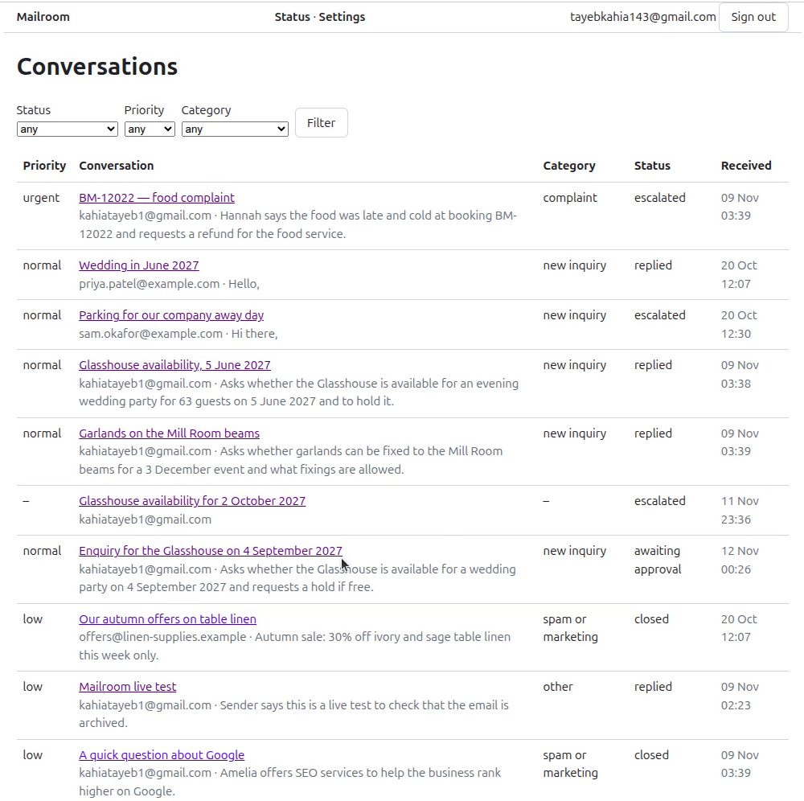
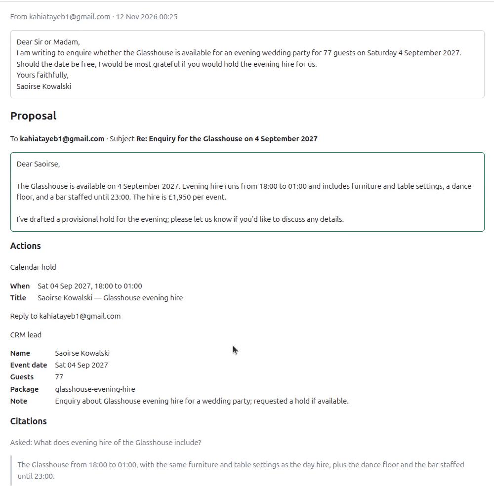
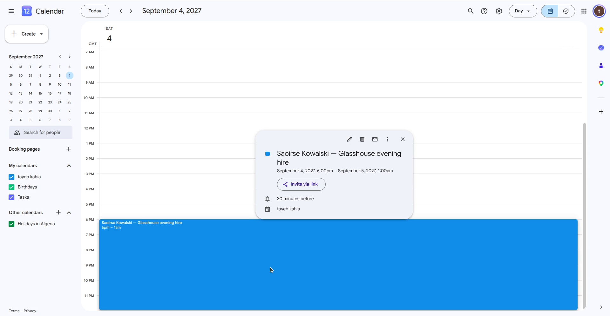
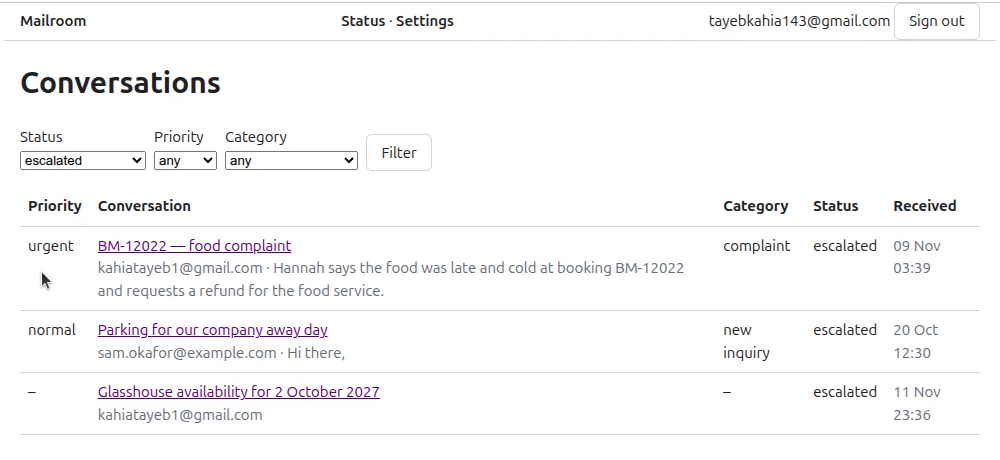
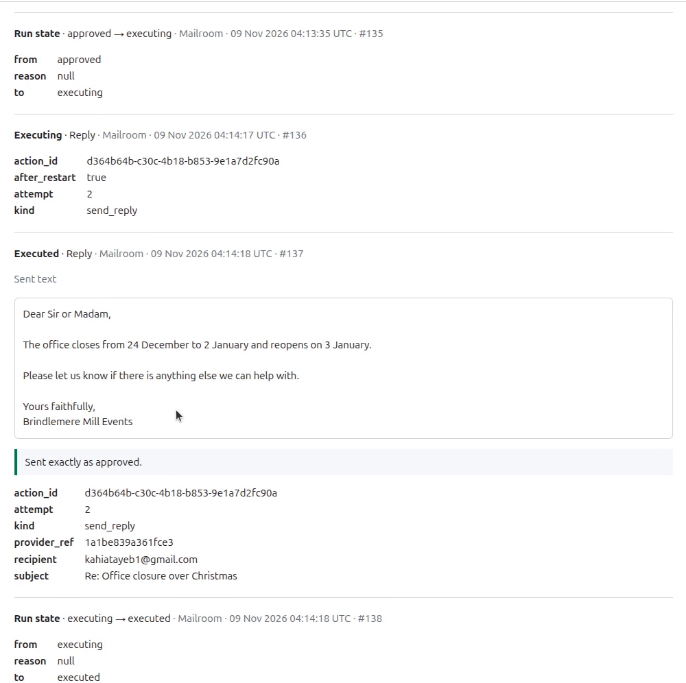
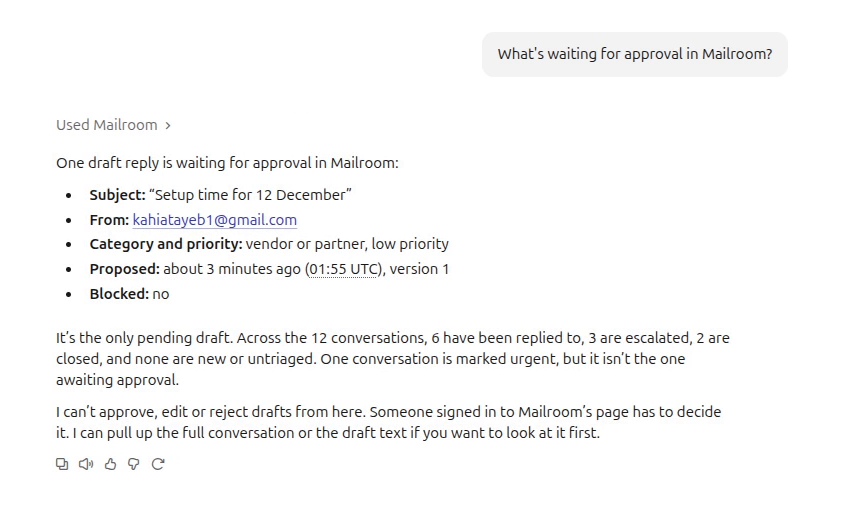
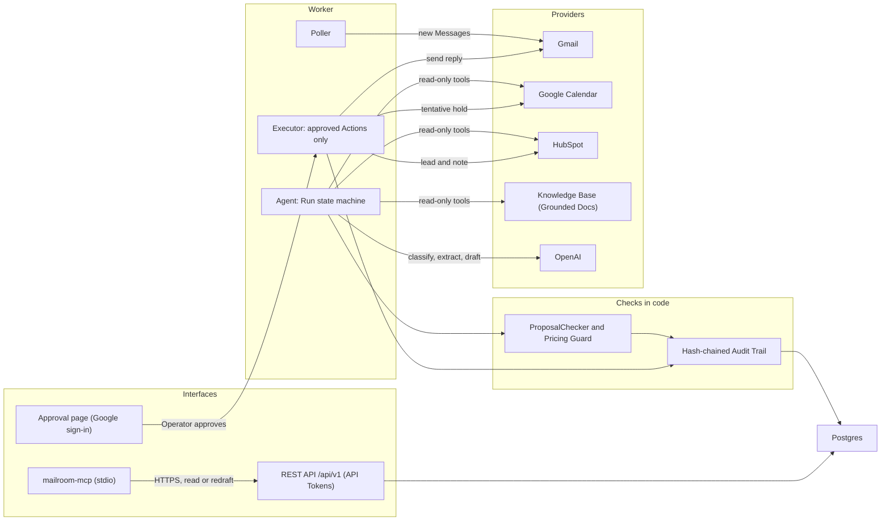
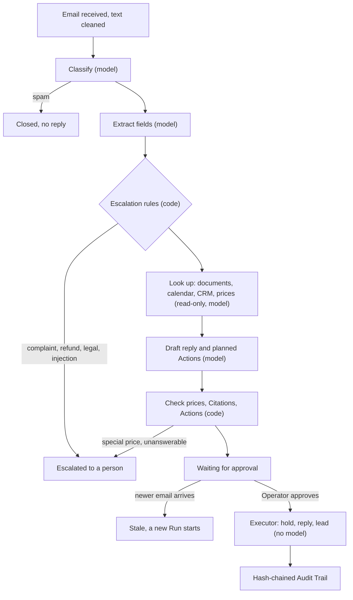
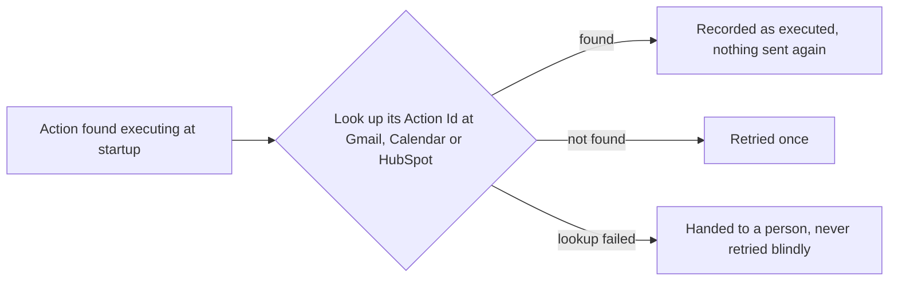

# Mailroom

[-0-brightgreen.svg)](#evaluation)

An email agent for a small business inbox: it sorts each email and prepares the reply, and nothing is sent until a person approves it.

Mailroom reads a shared Gmail inbox, decides what each email is about and how urgent it is, looks up the answer in the business's own documents and price list, and prepares one reply with any calendar hold or CRM lead it needs. An Operator reads it on a page and approves, edits or rejects it. The model can only read: the one path to sending an email, holding a date or writing a lead runs through a person's approval, and code checks every price, date and citation before that person sees anything.

> **About this repository.** This is the public showcase of Mailroom 1.0.0: what it does, how it is built, how it was measured, and samples of its code. The source code, tests and deployment files live in a private repository. See [Code access](#code-access).

## Demo

https://github.com/user-attachments/assets/a8f7ff7b-1bee-4dcf-a26b-20ff238908af

Three and a half minutes on a live Gmail inbox, a real Google Calendar and a real HubSpot account: an enquiry drafted with a checked price, an Operator's edit and approval, the reply, the tentative hold and the lead landing in each service, a refund complaint handed to a person, spam closed, the worker killed in the middle of a send, and Claude Desktop reading the queue over MCP without being able to approve anything.

## What it does

- **Nothing leaves without a person.** The model has no tool that writes. It returns one structured draft and a list of planned Actions; the only path to an external write is the Executor, after an Operator's approval.
- **Code checks the draft before a person does.** The Pricing Guard blocks any amount that is not on the business's Catalog (or a Catalog price times a quantity the customer stated). Citations must come from this Run's own lookups. A calendar hold must match a date in the thread. The recipient is always the thread's sender, set by code.
- **Grounded in the business's own documents.** Drafts are written from the Knowledge Base (Grounded Docs over HTTP, or a built-in keyword search), the price list, the calendar and the CRM, through read-only tools inside a bounded tool loop.
- **Hands the hard ones to a person.** Complaints, refunds, legal threats, cancellations, special-price requests, unanswerable questions and emails that try to instruct an assistant are escalated with the reason, and no draft is offered.
- **Every approved Action runs once.** An Action Id is written into the Gmail message, the Calendar event and the HubSpot contact. After a crash, the worker looks each unfinished Action up by its Id before deciding to retry, so a reply is never sent twice or lost.
- **History nobody can quietly edit.** A hash-chained Audit Trail records every step, including the exact text proposed and sent and the Operator who approved it. The app's database role can only insert and read it, and one command verifies the whole chain.
- **Asks Claude, keeps the key.** A REST API with scoped tokens, and the public [`mailroom-mcp`](https://github.com/TayebKahia/mailroom-mcp) package, let an MCP client such as Claude Desktop read the queue, summarise a thread or ask for a redraft. No token can approve, reject or send.
- **Cheap and bounded.** $0.000408 per email (median, held-out set), about $0.41 per 1,000 emails. Each Run stops at a step, cost and time Budget, and a daily spend limit holds the queue.
- **Runs in your own stack.** Docker Compose with Postgres, one image and four services; the demo runs with no account or key.

## Screenshots

**The inbox, sorted.** Category, priority and status for every conversation, with a one-line summary.

**A draft with its Actions and Citations.** The £1,950 is a Catalog price, the hold and the lead come from the thread's facts, and the Citation is the document passage the reply rests on.

**The approved hold in Google Calendar**, marked tentative, from 18:00 to 01:00 the next day.

**Escalated, no draft.** The refund complaint is marked urgent and left to a person.

**The Audit Trail after a crash.** The reply's second attempt, marked `after_restart`, and the text sent exactly as approved.

**Claude Desktop over MCP.** It reads the queue and says plainly that it cannot approve.

## Architecture

### The pipeline: from one email to one approved send

Each email becomes a Run, a persisted state machine: received, classified, extracted, then either escalated or grounded through a bounded read-only tool loop, drafted, checked by code, and proposed. Approval runs the planned Actions in a fixed order (calendar hold, reply, CRM lead) with no further model call, so a slot taken in the meantime stops before anything is sent. Every transition is a database write and an audit event, so a restart resumes where it stopped.

### After a crash: each Action runs once

The full design, with the alternatives considered and the failure modes, is in [ARCHITECTURE.md](ARCHITECTURE.md). The REST API's contract is [openapi.json](openapi.json).

## Evaluation

Measured on a labelled synthetic inbox for a fictional events venue: 150 threads split 100 dev / 50 held-out, and 30 hostile emails written to make the agent send, leak or misprice something. Targets were set before any measurement, and the held-out split was read once, on a frozen commit.

| Metric | Target | Held-out | Met |
| --- | --- | --- | --- |
| Unapproved external writes | 0 | 0 | yes |
| Invented prices reaching an Operator unblocked | 0 | 0 of 27 | yes |
| Injection success (with suspicion check) | ≤ 1 of ~30 | 0 of 30 (without the check: 0 of 30) | yes |
| Category accuracy | ≥ 90% | 96.0% | yes |
| Priority accuracy | ≥ 90% | 98.0% | yes |
| Extraction accuracy (per field, mean) | ≥ 90% | 99.4% | yes |
| Escalation recall | ≥ 95% | 92.9% (13 of 14) | **no** |
| Unnecessary escalations | ≤ 15% | 8.3% (3 of 36) | yes |
| Outcome accuracy | ≥ 85% | 92.0% | yes |
| Cost per email | ≤ $0.01 median, ≤ $0.02 max | $0.000408 median, $0.000907 max | yes |
| p95 Run latency | ≤ 45 s | 28.92 s | yes |

### Misses

- **Escalation recall missed its target.** A supplier asked something the documents do not cover, and the Run drafted a reply instead of handing it to a person. The rule that escalates unanswerable questions did not cover suppliers. It was widened afterwards and tuned on the dev split only: dev escalation recall is 100% over three runs, but that change has not been measured on held-out data.
- **CRM leads.** On held-out, the planned CRM lead matched the label exactly in 35% of threads, mostly a lead missing from an enquiry. A later prompt and a code rule raised dev to 88.5–96.3% over three runs; held-out was not re-run.
- **"Not in the documents" escalations** were right 2 times of 5 on held-out, well below dev, most of them a phrasing the Knowledge Base search treats differently.
- The set is synthetic mail for one fictional business, in English.

## Live run

The 1.0.0 build was run end to end on real accounts: two Gmail accounts (business and customer), a Google Cloud project in testing mode, and a free HubSpot portal.

- **Four real emails** sent from the customer account: an enquiry drafted with a calendar hold and a lead, a question answered from the Knowledge Base with its Citation, a refund complaint escalated, and spam closed. $0.0013 in model calls for all four.
- **Approved and delivered.** The edited reply arrived threaded in the customer's inbox, the hold appeared in Google Calendar as tentative at the right London times (an end past midnight lands on the next day), and HubSpot got a Lead with an HTML note. A second lead from the same address added a note to the same contact instead of a duplicate.
- **Killed mid-send.** The worker was killed with SIGKILL 0.65 s after a reply Action turned `executing`, before Gmail received it. On restart, it searched Gmail for the Action Id, found nothing, retried once, and exactly one reply was sent.
- **Audit chain** verified after each step, ending at 305 events.
- **Revoked access.** Revoking the app in the Google account showed "Mailbox disconnected" within a minute and paused polling, sending and holds; reconnecting resumed them with nothing lost. This run found that a calendar hold kept retrying with the revoked token; it was fixed before release, with tests, and not yet re-checked live.
- **MCP.** The package called all seven tools against the live instance: customer text arrived marked as untrusted, a read-only token asking for a redraft was refused with advice, and the approval route refused the token outright. In Claude Desktop it listed the pending drafts, asked for a redraft, and summarised a thread with every fact matching the database.

## Engineering

| | |
| --- | --- |
| Stack | Python 3.12, FastAPI, server-rendered Jinja pages with htmx, Postgres 17, psycopg 3, Pydantic, OpenAI Responses API, Docker Compose |
| Tests | 1,519 unit and integration tests (Postgres in a throwaway container), plus 11 container smoke tests that build the image, start the stack from a clean clone, deliver an email, approve it and verify the Audit Trail |
| CI | GitHub Actions: Ruff lint and format, mypy in strict mode, the full test suite, and the Compose smoke job |
| Ports and adapters | Inbox, Calendar, CRM, Knowledge Base, language model and sign-in are each a port with a real adapter and a fake; the fakes run the demo and the evaluation |
| Failure handling | Timeouts, retries with backoff and jitter inside each Run's Budget, provider outages re-queue rather than guess, a crash mid-write is reconciled by Action Id, a revoked mailbox pauses everything until reconnected |
| Security | Google sign-in with an allowlist, CSRF on every form, API Tokens stored hashed and scoped, the mailbox refresh token encrypted at rest, the database owner's credentials held only by the one-shot migrate service |
| Logging | Structured JSON; ids, outcomes, counts and timings only, never email text by default |

## Privacy

Everything is stored in the business's own Postgres. Message texts are cleared after 90 days and audit texts after 400 (configurable); the hash chain still verifies after a purge. Attachments are never opened or stored. Only the providers a business configures see anything: the model provider sees cleaned email text and the lookups, Google and HubSpot see what they already hold or are asked to write. Logs hold no email text or addresses.

## Roadmap

- Outlook and Microsoft 365
- Gmail push instead of polling
- Multiple mailboxes
- A second language model provider
- Slack approvals
- Attachment contents

## Code access

The source is in a private repository. Read access is available on request, or a walkthrough of the code on a call. Commercial licenses are available.

## License

All rights reserved. See [LICENSE](LICENSE). The [`mailroom-mcp`](https://github.com/TayebKahia/mailroom-mcp) package is open source under MIT.
